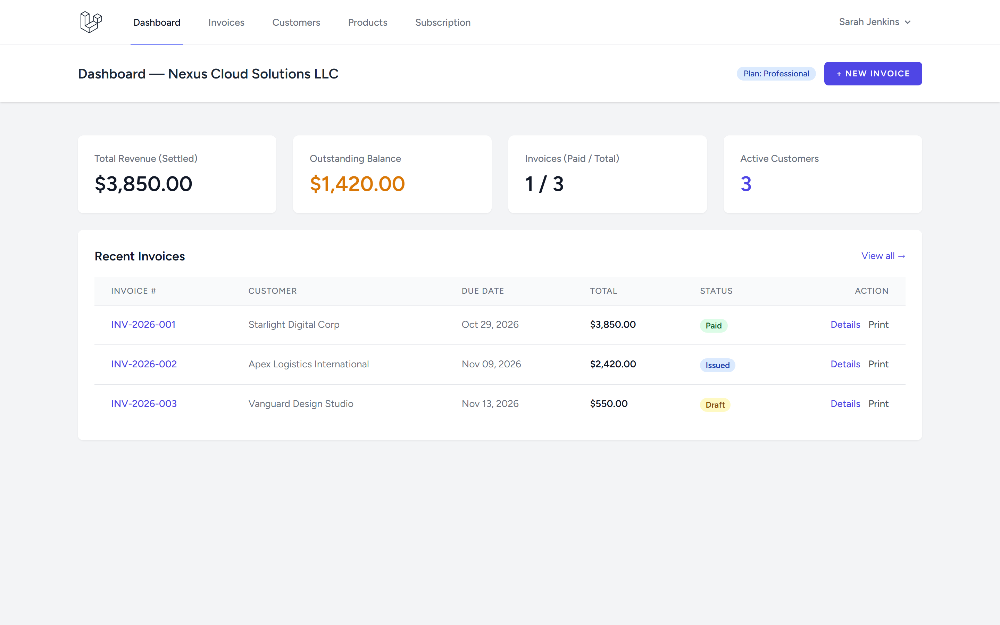
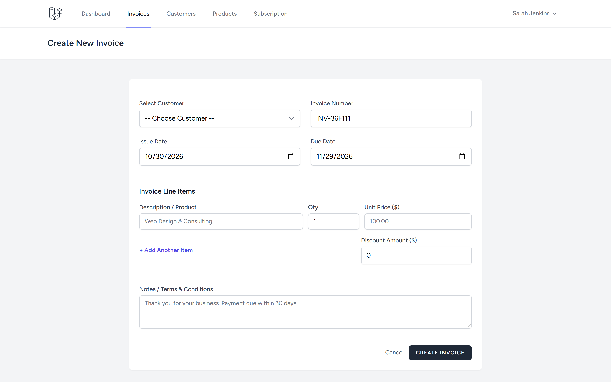
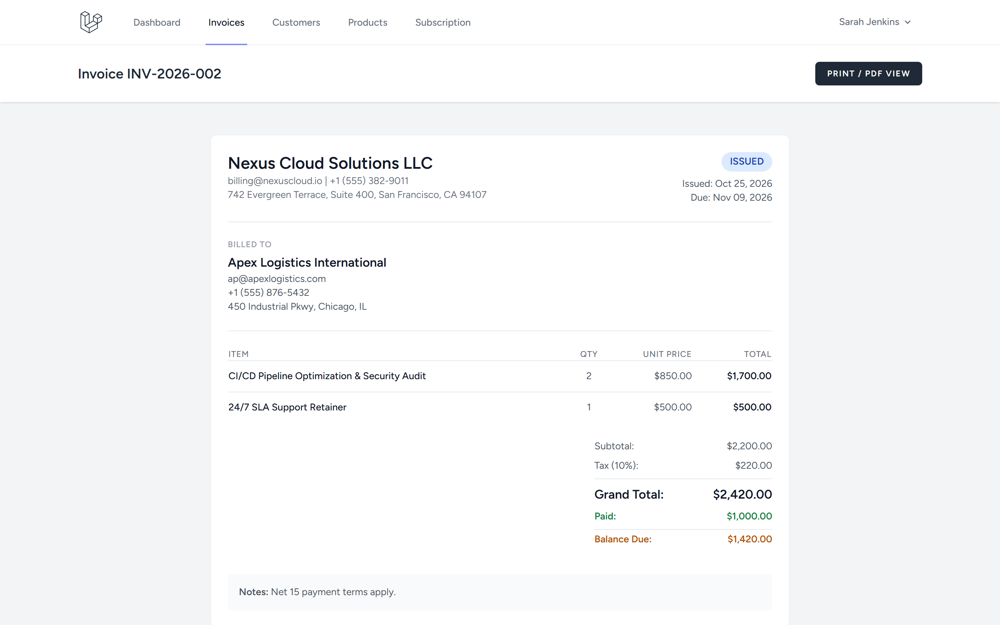
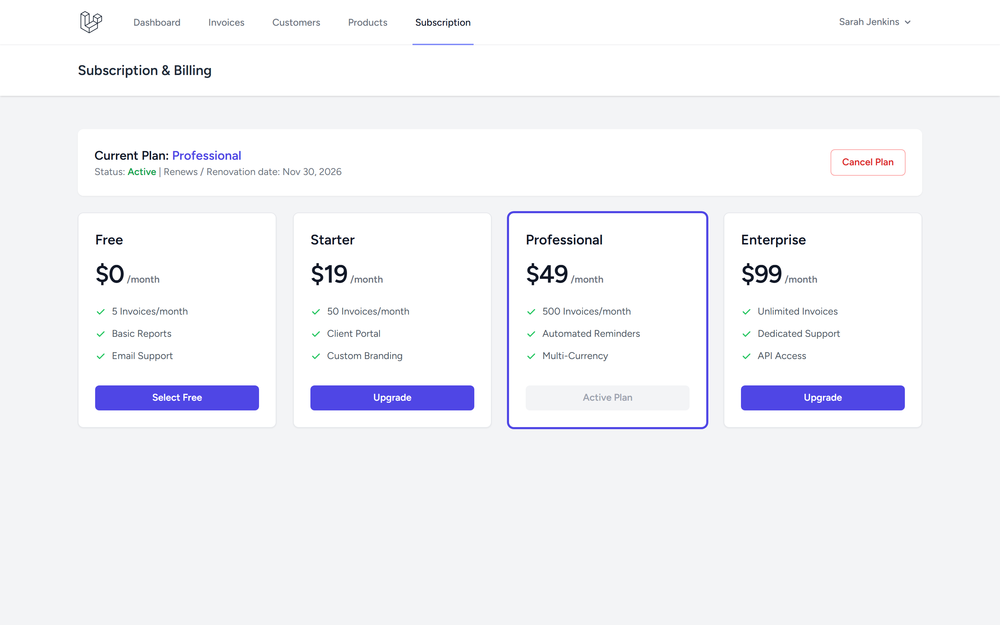

# SaaS Invoice Platform (Laravel)

Production-ready multi-business SaaS invoicing platform built with Laravel 11/13, Blade, Tailwind CSS, and integer-minor-unit financial accuracy.

[]()
[]()

---

## 1. Project Overview

The **SaaS Invoice Platform** provides businesses with full lifecycle invoice management: client directories, item catalogs, integer-safe tax and discount calculations, status workflows (draft, issued, paid, overdue, cancelled), payment records, printable PDF views, and simulated tier-based subscriptions.

---

## 2. Key Features

- **Financial Integrity**: Monetary values stored as minor units (integer cents), preventing floating-point rounding errors.
- **Invoice Lifecycle**: Dynamic state machine with automated status transitions (`draft` &rarr; `issued` &rarr; `paid` &rarr; `overdue` / `cancelled`).
- **Server-Side Recalculations**: Server calculates subtotal, 10% tax, discounts, and outstanding balances.
- **Client & Product Catalogs**: CRUD directories scoped strictly to the authenticated user's business entity.
- **Partial & Full Payments**: Track payment logs with methods (`bank_transfer`, `credit_card`, `cash`) preventing overpayments.
- **Printable & PDF Ready**: Clean, dedicated print stylesheet for zero-dependency printing or PDF rendering.
- **Subscription Simulation**: Multi-tier subscription model (`Free`, `Starter`, `Professional`, `Enterprise`) with cancellation and period tracking.

---

## Screenshots

| Tampilan | Preview |
|---|---|
| **Dashboard Operasional SaaS Invoice**<br>Ringkasan total pendapatan terselesaikan, saldo tertunggak, rasio faktur lunas, serta tabel faktur terbaru |  |
| **Pembuat Faktur & Rincian Item**<br>Formulir pembuatan faktur interaktif dengan pemilihan klien, penambahan item produk dinamis, diskon, dan catatan |  |
| **Detail Faktur & Buku Besar Pembayaran**<br>Rincian lengkap faktur dengan rincian subtotal, kalkulasi pajak 10%, sisa tagihan, dan riwayat cicilan pembayaran |  |
| **Manajemen Paket Langganan SaaS**<br>Pusat pengelolaan tingkatan paket (Free, Starter, Professional, Enterprise), fitur komparasi, dan status langganan aktif |  |

---

## 3. Technology Stack

- **Framework**: Laravel 11/13
- **Authentication**: Laravel Breeze
- **Database**: SQLite (default local & testing) / PostgreSQL compatible
- **Frontend**: Blade + Tailwind CSS + Vite
- **Testing**: PHPUnit / Pest (32 automated tests)

---

## 4. Requirements & Installation

### Requirements
- PHP >= 8.3 with `pdo_sqlite` / `pdo_pgsql`, `mbstring`, `openssl`
- Composer 2.x
- Node.js >= 20.x

### Quickstart

```bash
# Clone repository
git clone https://github.com/0xyz-exe/saas-invoice-platform-laravel.git
cd saas-invoice-platform-laravel

# Setup environment & dependencies
cp .env.example .env
composer install
php artisan key:generate

# Run migrations & seeders
touch database/database.sqlite
php artisan migrate

# Build frontend assets
npm install
npm run build

# Start dev server
php artisan serve
```

---

## 5. Verification & Testing

```bash
# Run test suite
php artisan test

# Validate Composer
composer validate

# Audit production npm packages
npm audit --omit=dev
```

Test coverage includes:
- Multi-business tenant scoping & authorization checks (403 forbidden on cross-entity access)
- Precision calculations on invoices with line-items, discounts, and taxes
- Partial payment and full settlement status transitions
- Prevention of overpayment and payments on cancelled/draft invoices
- Subscription tier management

---

## 6. Architecture & Data Model

- `Business`: Tenant business profile (name, currency, tax ID, user association)
- `Customer`: Client contact and billing address
- `Product`: Catalog items and baseline unit prices
- `Invoice`: Financial document with status, subtotal, tax, discount, total cents
- `InvoiceItem`: Quantities, itemized prices, line totals
- `Payment`: Financial transaction logs linked to invoices
- `Subscription`: Tier entitlements and renewal cycles

---

## 7. License

MIT License. Developed as part of the Laravel Projects Factory.
